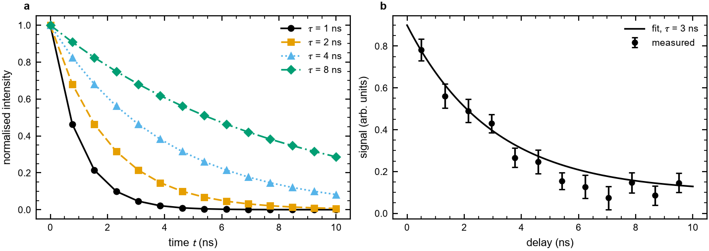
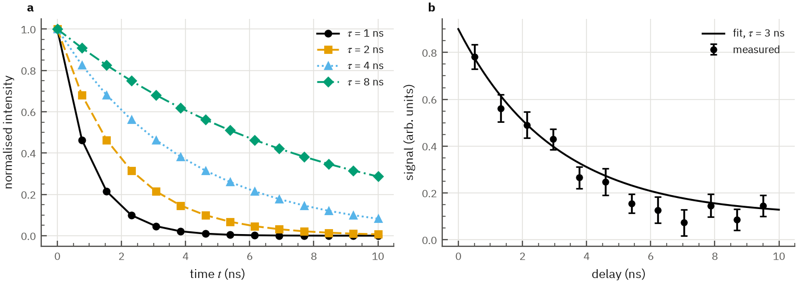

# qoraplot

[English](README.md) | [한국어](README.ko.md)

An Origin-like publication style for matplotlib: ticks inside on all four sides with minor ticks,
a closed frame, no grid and a sans-serif face, sized for journal columns, slides and posters. The
colour, marker and dash cycle comes from [cvdkit](https://github.com/NaNIsaac/cvdkit), so series
stay apart with colour-vision deficiency.

qoraplot is not affiliated with OriginLab; "Origin-like" only describes the look.

## Install

qoraplot needs Python 3.12 or newer. Until the first release is on PyPI, install it from a clone of
this repository:

<!-- test unix -->
```sh
uv venv
uv pip install .
```

<!-- test windows -->
```powershell
uv venv
uv pip install .
```

Check that it imports:

<!-- test unix -->
```sh
uv run --no-project python -c "import qoraplot; print(qoraplot.VARIANTS)"
```

<!-- test windows -->
```powershell
uv run --no-project python -c "import qoraplot; print(qoraplot.VARIANTS)"
```

## Use

```python
import matplotlib.pyplot as plt
import numpy as np
import qoraplot

qoraplot.use("paper")  # or "slide", "poster"; applies to later figures

fig, ax = qoraplot.figure("single")  # 3.5 in wide; "double" is 7.2 in
x = np.linspace(0, 10, 30)
for tau in (1, 2, 4):
    ax.plot(x, np.exp(-x / tau), label=f"tau = {tau}")
ax.set_xlabel("time (ns)")
ax.legend()
qoraplot.panel_label(ax, "a")
fig.savefig("figure.pdf")  # 300 dpi for paper, TrueType fonts embedded

with qoraplot.style("poster", "house"):  # only inside the block; save inside it too
    fig, ax = qoraplot.figure(14.4, aspect=0.5)
    ax.plot(x, np.sin(x))
    fig.savefig("poster_panel.png")
```

Fonts are looked up when a figure is drawn, so with `style(...)` call `savefig` inside the block.

## Variants

Two variants on the same data. The default is `box` until one is chosen.

- `box`: closed frame, ticks inside on all four sides, minor ticks, no grid, Arial or Helvetica
  (falling back to Liberation Sans, then DejaVu Sans), black ink.
- `house`: open L frame, grey axes and ticks, near-black text, light grid, IBM Plex Sans (bundled)
  with STIX math, ticks inside.

`box`:



`house`:



Both as seen with deuteranopia (cvdkit simulation): [docs/variants_deutan.png](docs/variants_deutan.png).
The figures are drawn by `examples/variants.py`.

## License

MIT. IBM Plex Sans is bundled under the SIL Open Font License 1.1
([src/qoraplot/fonts/OFL.txt](src/qoraplot/fonts/OFL.txt)).
